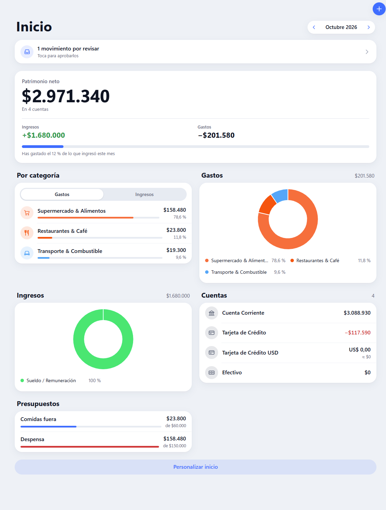
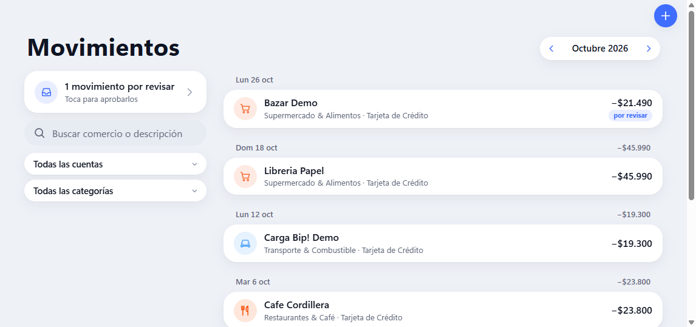
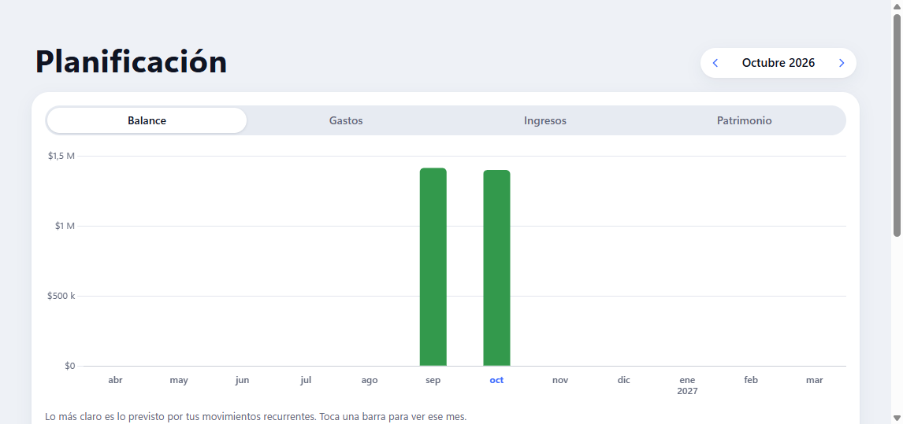
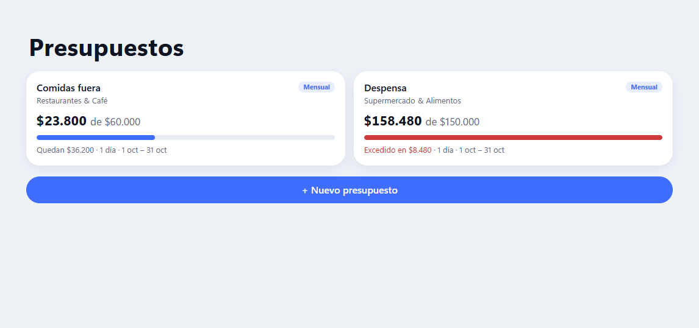
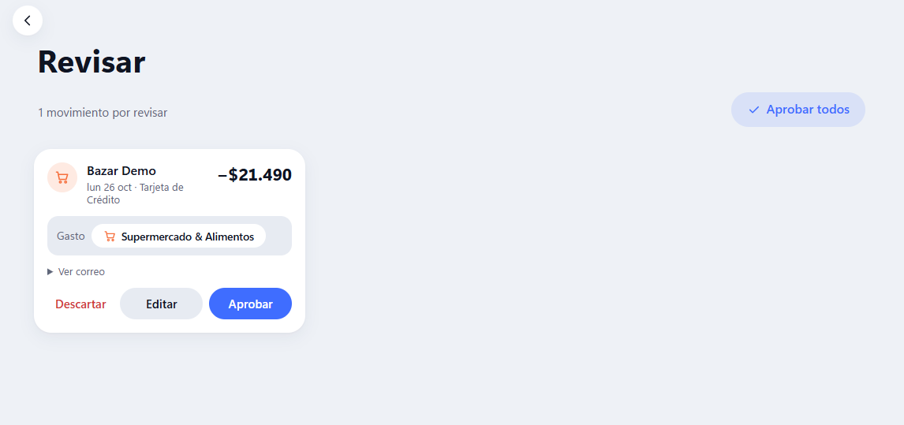

# Expense Tracker para Asustor AS-202TE

Aplicación web personal para registrar gastos e ingresos, pensada para usar también desde el teléfono. Importa
automáticamente los movimientos que notifican los bancos chilenos por correo (Gmail, Outlook u otros buzones
IMAP/POP3), los deja pendientes de revisión con una categoría sugerida y aprende de las correcciones.

Funciona en el NAS **Asustor AS-202TE** (Intel Atom de 32 bits, 1 GB de RAM, ADM 3.5.x y Python 3.11 mediante
Entware) y en computadores con Python 3.10 o posterior. Está orientada a Chile: usa pesos chilenos (CLP),
convierte USD, EUR y UF con valores oficiales, y reconoce notificaciones de bancos chilenos.

## Funciones

- **Inicio**: patrimonio, ingresos y gastos del mes, categorías, cuentas y presupuestos. Cada usuario elige qué
  paneles mostrar y en qué orden.
- **Movimientos**: historial diario con búsqueda y filtros por cuenta o categoría. La vista **Revisar** permite
  confirmar o editar movimientos importados y movimientos recurrentes pendientes.
- **Plan**: gráficos mensuales de saldo, gastos, ingresos o patrimonio; los meses futuros incluyen movimientos
  recurrentes previstos.
- **Presupuestos**: límites por categorías, periodos diarios, semanales, mensuales o anuales, y montos fijos o
  porcentajes del ingreso mensual esperado.
- **Configuración**: apariencia, idioma, cuentas, categorías, movimientos recurrentes, reglas, correo, bancos,
  respaldos, importación CSV, contraseña y usuarios.
- **Saldos calculados**: saldo inicial más movimientos confirmados, convertidos a la moneda de la cuenta según
  el tipo de cambio de cada movimiento. Las correcciones de saldo se registran como ajustes, no como ingresos ni gastos.
- **Movimientos recurrentes**: cada repetición se registra en su fecha aunque el NAS haya estado apagado. Una
  repetición programada para el día 31 ocurre el último día de los meses más cortos.
- **Multimoneda**: CLP, USD, EUR y UF, con valores diarios de [mindicador.cl](https://mindicador.cl), sin credenciales.
- **Clasificación**: reglas (por ejemplo, `jumbo OR lider`), aprendizaje por comercio y un clasificador Naive Bayes
  como último recurso.
- **Usuarios independientes**: cada usuario tiene sus propias cuentas, movimientos, categorías, reglas y buzones.
  No hay registro público; el primer usuario se crea al iniciar la aplicación y es administrador.

## Capturas de pantalla

Ejemplos de las principales vistas. Todas las capturas usan datos ficticios.



<table>
  <tr>
    <td align="center"><strong>Movimientos</strong><br></td>
    <td align="center"><strong>Planificación</strong><br></td>
  </tr>
  <tr>
    <td align="center"><strong>Presupuestos</strong><br></td>
    <td align="center"><strong>Revisión</strong><br></td>
  </tr>
</table>

## Idiomas

La interfaz está disponible en español e inglés. Cada usuario elige el idioma en **Configuración > Apariencia >
Idioma**; la opción *Sistema* sigue el idioma del dispositivo. La preferencia se guarda también en el servidor para los mensajes de tareas automáticas.

Las traducciones están en:

- Interfaz web: `package/app/static/js/locales/<código>.js`.
- Mensajes y datos iniciales del servidor: `package/app/i18n/<código>.py`.

Para agregar un idioma, traduce los valores sin cambiar las claves ni los `{marcadores}`, registra el idioma en
ambos catálogos y añádelo a `LANGUAGE_NAMES` en `package/app/static/js/i18n.js`. `tests/test_i18n.py` comprueba
que las claves y los marcadores coincidan.

## Ejecución manual en Windows

Abre PowerShell en la carpeta raíz del proyecto. Instala Python 3.11 (se admite Python 3.10 o posterior) y ejecuta:

```powershell
py -3.11 -m venv .venv
.\.venv\Scripts\python.exe -m pip install -r package\requirements.txt
.\.venv\Scripts\python.exe -m uvicorn app.main:app --app-dir package --host 127.0.0.1 --port 8010 --reload
```

Abre `http://localhost:8010` y crea el primer usuario administrador. La documentación de la API está en
`http://localhost:8010/docs`. Detén el servidor con `Ctrl+C`.

También puedes ejecutar `run_local.bat` después de instalar las dependencias; usará `.venv` si existe. Para
acceder desde otros dispositivos de la red, cambia `--host 127.0.0.1` por `--host 0.0.0.0`, permite el puerto
8010 en el firewall de Windows para redes privadas y sigue las recomendaciones de [Seguridad](#seguridad-y-datos).

## Pruebas y desarrollo

Para instalar también las dependencias de prueba y ejecutar la suite:

```powershell
.\.venv\Scripts\python.exe -m pip install -r requirements-dev.txt
.\.venv\Scripts\python.exe -m pytest tests
```

Las pruebas usan bases temporales y no modifican `package/data/`.

## Instalación en el NAS

1. Instala **Entware** desde App Central en ADM.
2. Desde Windows, crea el paquete APKG en la raíz del proyecto (consulta [Preparar el paquete](#preparar-el-paquete))
   o descarga un APKG de la sección Releases de GitHub.
3. En ADM, abre **App Central > Administración > Instalación manual** y selecciona el APKG descargado o
   `dist/expense-tracker.apk` si lo compilaste localmente.
4. Abre la aplicación en `http://<IP_DEL_NAS>:8010` y crea el administrador inmediatamente. Mientras no exista
   ningún usuario, la primera persona que abra la aplicación podrá crear esa cuenta.

Las actualizaciones conservan `data/app.db` y `data/users/`. Las bases de datos, registros, respaldos y la clave
de cifrado se mantienen en el NAS y no se incluyen en el paquete.

## Preparar el paquete

Desde la raíz del proyecto, ejecuta en PowerShell. El empaquetador solo usa la biblioteca estándar de Python:

```powershell
py -3.11 build_package.py
```

El archivo se genera en `dist/expense-tracker.apk`. Por defecto, el comando incrementa la versión del paquete;
usa `py -3.11 build_package.py --no-bump` para conservarla. `build.bat` ofrece el mismo proceso si Python está
disponible en `PATH`.

## Usuarios y respaldos

- **Crear**: en **Configuración > Usuarios > Nuevo usuario**, indica nombre de usuario, nombre, contraseña y si
  será administrador. Cada usuario nuevo comienza con cuentas, categorías, reglas y bancos predeterminados.
- **Restablecer contraseña o desactivar**: cierra de inmediato las sesiones abiertas de ese usuario. Un usuario
  desactivado conserva sus datos y puede reactivarse.
- **Eliminar**: debes escribir el nombre de usuario para confirmar. Su base de datos se archiva en
  `data/users/deleted/` en el NAS; no se borra.
- Siempre debe quedar al menos un administrador activo.
- **Respaldar**: en **Configuración > Datos y respaldo**, cada usuario descarga sus propios datos. Un administrador
  también puede descargar el respaldo completo (`.zip` con `app.db` y todas las bases de datos de `users/`).
  Las contraseñas y los tokens del correo se cifran con `data/secret.key`, que no forma parte del respaldo. Al
  restaurar en otro dispositivo, hay que volver a ingresar o conectar las cuentas de correo.

## Configuración del correo

En **Configuración > Correo**, cada usuario agrega buzones, configura la sincronización automática y usa **Probar**.
En **Configuración > Bancos** se revisan los remitentes y la cuenta predeterminada de cada banco.

- **Gmail**: activa la verificación en dos pasos, crea una [contraseña de aplicación](https://myaccount.google.com/apppasswords)
  y úsala como contraseña del buzón.
- **Outlook, Hotmail y Microsoft 365**: se conectan mediante OAuth2. Cada usuario registra su propia aplicación
  en [Microsoft Entra](https://entra.microsoft.com) > **Registros de aplicaciones**. Selecciona el tipo de cuenta
  «Cualquier directorio organizativo y cuentas personales de Microsoft», activa **Permitir flujos de cliente públicos**
  y agrega el permiso delegado `IMAP.AccessAsUser.All` de Office 365 Exchange Online. Ingresa el «Id. de aplicación
  (cliente)» en el buzón y sigue el código que muestra **Conectar con Microsoft** en `microsoft.com/devicelogin`.
  En cuentas de trabajo, el administrador podría tener que aprobar la aplicación o habilitar IMAP.
- **Otros buzones IMAP**: configura servidor, puerto y seguridad (SSL/TLS o STARTTLS). Las carpetas son opcionales;
  si no se indican, se revisa la bandeja de entrada y, si está vacía, la carpeta «All Mail».
- **POP3**: solo revisa la bandeja de entrada y lee encabezados desde el correo más reciente. No elimina mensajes.
  Gmail por POP entrega cada mensaje una sola vez.

## Seguridad y datos

La aplicación sirve **HTTP sin cifrado TLS**. Úsala solo en una red local de confianza o mediante una VPN; no
expongas ni redirijas el puerto 8010 a Internet. Crea el primer usuario administrador antes de dejar el servicio
accesible a otros dispositivos.

Las credenciales de correo se guardan cifradas con `data/secret.key`. Esa clave no se incluye en los respaldos;
al restaurar en otro dispositivo hay que volver a ingresar o conectar las cuentas de correo. Los respaldos se
descargan desde **Configuración > Datos y respaldo**: cada usuario obtiene sus propios datos y un administrador
puede descargar el respaldo completo.

## Arquitectura

- **Servidor**: FastAPI `<0.100`, Pydantic v1, SQLAlchemy 1.4 y SQLite en modo WAL; compatible con 32 bits.
- **Interfaz**: HTML, CSS y JavaScript sin dependencias externas ni compilación, en `package/app/static/`.
- **Tareas automáticas**: APScheduler sincroniza correo cada cierto intervalo y actualiza los tipos de cambio a diario.
- **Datos**: `data/app.db` guarda los usuarios y `data/users/<id>.db` los datos de cada uno. Las migraciones se
  ejecutan al abrir por primera vez cada base de datos.
- **Importación de instalaciones antiguas**: la migración desde la base de datos de un solo usuario está en
  `package/app/core/app_setup.py`.
- **Traducciones**: mensajes del servidor en `package/app/i18n/` e interfaz web en `package/app/static/js/locales/`;
  consulta [Idiomas](#idiomas).

## Licencia

El proyecto se distribuye bajo la licencia [MIT](LICENSE). Chart.js, incluido en
`package/app/static/js/vendor/`, también se distribuye bajo MIT.
